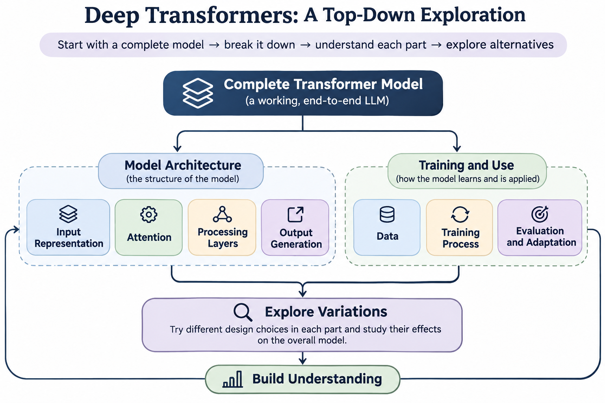

# Deep Transformers
_Understanding Transformers by building, breaking, experimenting, and investigating._

## About the Project

An experimental exploration of the Transformer architectures, neural network components, training methodologies, and model behaviour.

The central goal is to dig deep into Transformer concepts, understand their mathematical and computational foundations, and investigate how different design and implementation choices influence model learning and behaviour.

## Our Approach

## Areas of Exploration

The project will explore different aspects of Transformer models through hands-on implementation, experimentation, and comparative analysis.

Some initial areas of exploration include:

1. **Model Architecture:** Breaking down the overall architecture into its constituent components and understanding how they work together.
2. **Input Processing:** Exploring different ways of preparing and representing input data.
3. **Design Alternatives:** Investigating alternative implementations and design choices within individual components.
4. **Training Methodologies:** Experimenting with different approaches to training neural networks and understanding their effects on learning.
5. **Model Evaluation:** Comparing model performance, behaviour, and generalization across different architectures and datasets.
6. **Experimental Analysis:** Studying how individual design choices influence the behaviour and performance of the overall model.

These areas are exploratory rather than exhaustive. The scope will evolve as the project progresses and new questions emerge.
